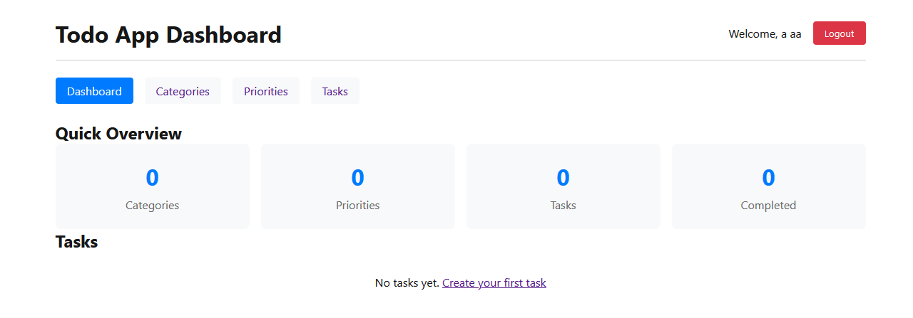
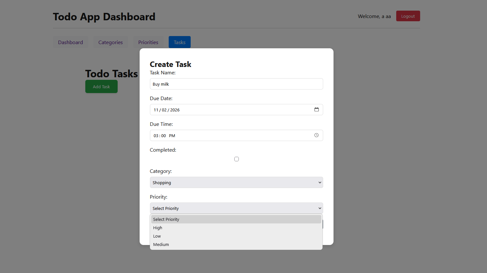

# Kerlem Todo

A task management app built with Next.js, React, and TypeScript. It connects to the external TalTech Todo REST API for authentication and data storage.

## Features

- Account registration and login with JWT authentication and token refresh
- Create, edit, delete, and complete tasks with due dates
- Manage categories and priorities, and filter tasks by either
- View task and completion statistics

## Screenshots

### Task dashboard

### Adding tasks

